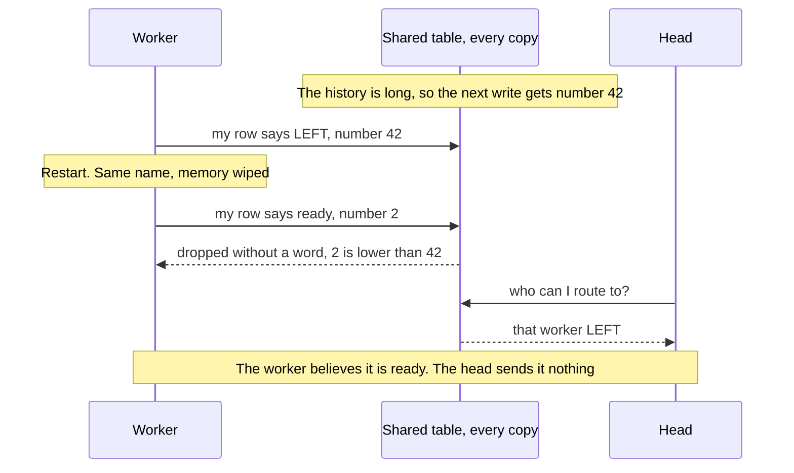
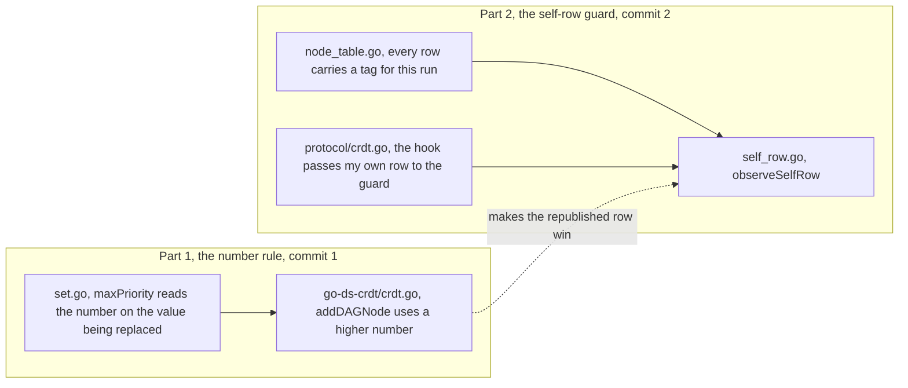
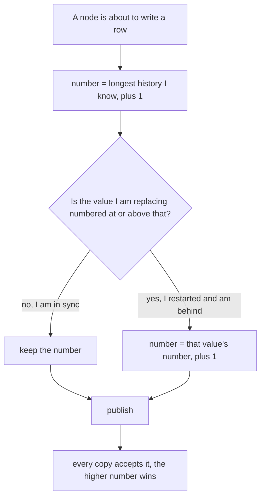
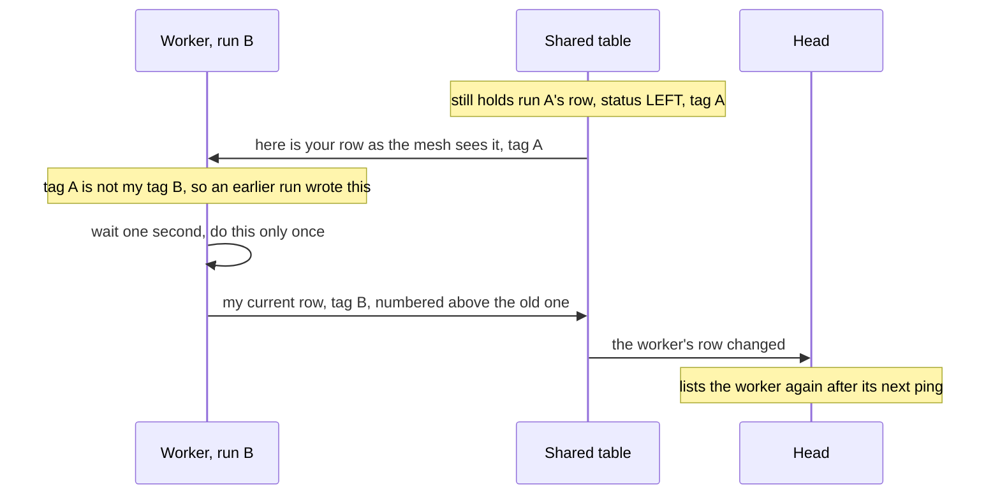

# Walkthrough: the OpenTela #73 fix, in plain words

A reading aid for you, not for upstream. It explains the two commits in `vendor/export/OpenTela` so you can read the diff and defend it.

## The setting

OpenTela machines (one head, many workers) share a table: who is alive and what each serves. Every machine keeps its own copy, and the copies sync by gossip. When two versions of the same row meet, the one with the higher **number** wins. The number is "how long the history was when I wrote this, plus one".

## The bug

A restarted worker keeps its name but forgets the history, so it numbers its new row 1 or 2. Everyone still holds its old LEFT row at 42 and keeps that. Until March a timer re-announced every two minutes and hid this; that timer was removed to stop the history growing.

## The fix has two parts

**Part 1: never write below what you are replacing.**

When a node is in sync the answer is always "no", so nothing changes for healthy nodes. This is the rule of a Lamport clock.

**Part 2: notice your own stale row and answer it once.**

Each run of a node picks a random tag (`localIncarnation`) and stamps it on every row it publishes. If the row that wins for its own name carries another tag, an earlier run wrote it, and the node republishes once. A row with its own tag is left alone, even an eviction by a head, so the guard never fights a decision about the current run. It also stays quiet once the node is leaving on purpose.

## Read the diff in this order

1. `src/internal/protocol/self_row.go` (74 lines, new). The whole guard. Check: the two early returns, the one-second timer, and that it does nothing while leaving.
2. `src/internal/protocol/go-ds-crdt/crdt.go` (16 lines). The number rule. Check: it only ever raises the number.
3. `src/internal/protocol/go-ds-crdt/set.go` (24 lines). `maxPriority`. Check: it takes the same lock a merge takes, so it never reads half a merge.
4. `src/internal/protocol/node_table.go` (7 lines). The new field, the stamp, and the "leaving" flag.
5. `src/internal/protocol/crdt.go` (4 lines). One call added where the node sees its own row.
6. The two test files (435 lines). One test rebuilds the bug with two replicas and fails on `main`; five small tests pin the guard's behaviour.

## Questions a reviewer may ask

- **Does it bring back periodic writes?** No. One extra write per restart.
- **Old nodes that send no tag?** An empty tag is "not mine", so the node republishes once. There is a test for it.
- **Can two nodes fight forever?** No. A node only reacts to a row with a different tag under its own name, and its answer carries its own tag.
- **Why touch the forked go-ds-crdt?** Because the drop happens there. The change is local to keys the node itself writes.
- **Was it measured on the real mesh?** No. Localhost only, three runs per case, and the PR says so.

## What only you can do

The checks, the leak check and the identity are done. Left for you, from `CHECKLIST.md`: read the diff, rewrite `PR.md` in your own words, and choose: on top of PR #72 or independent of it (it applies either way), and whether to offer the third patch now or after. Both commits and the PR text say `Refs #73`; closing the issue is left to the maintainer.
